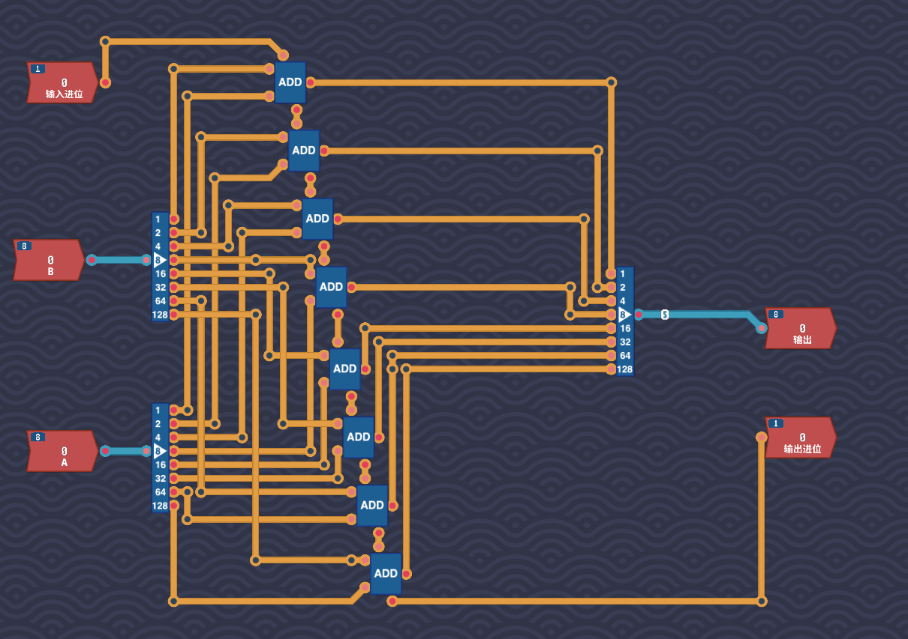

# Turing-Complete-Hardware
My digital logic design and CPU architecture journey.
# 我的图灵完备记录

##  里程碑 1：单字节加法器 (8-bit Adder)

**功能说明**：
- 实现了两个 8 位二进制数及一个进位输入的相加。
- **核心逻辑**：采用多个全加器级联，实现**行波进位（Ripple Carry）**，最终输出一个 8 位结果及最终的进位输出。
